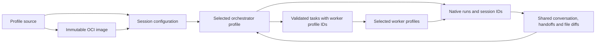

# Profiles, sessions and native runs

This document describes the current Subharness runtime. For the planned web client and local Node host, see [system overview](SYSTEM_OVERVIEW.md) and the [UI protocol](UI_PROTOCOL.md).

An **Agent Profile** describes one harness, model, instructions, skills and plugins. An **image** distributes a profile with its source checksum and native runtime requirements. A **session** selects the profiles and assigns their roles. A **run** records one native harness invocation, including planner calls and retry attempts.



## Select both harnesses through profiles

```sh
# Claude leads; OpenCode implements and reviews.
node bin/subharness.mjs run --orchestrator ui --worker implement --worker review --title "Feature work" --cwd /path/to/project

# Source directories and locally installed images work in either role.
node bin/subharness.mjs run --orchestrator ./my-planner --worker owner/builder:1.0.0 --cwd /path/to/project

# Open one profile directly, without planning/delegation.
node bin/subharness.mjs run ui --cwd /path/to/project

# Restore the saved profiles, models, roles and exact image digests.
node bin/subharness.mjs run --resume latest --cwd /path/to/project
```

The `ui` example reuses its existing Claude model and UI skill. For daily use, fork it and give the planner appropriate planning instructions/capabilities. Changing roles does not rewrite the profile's instructions. Live Claude execution requires working native authentication.

`--worker` is repeatable. If omitted, local profiles with the legacy worker hint form the default pool. If no `--orchestrator` is given, the built-in `orchestrator` is used. The orchestrator chooses among that pool for every task. Selecting an image requires pulling/building it first; launching never downloads an unreviewed image implicitly.

The manifest's existing `role` field is a **default selection hint**, retained for old profiles/images. Explicit session/team selection takes precedence. A `team.json` assigns its orchestrator and workers regardless of those hints. Selected IDs must be unique and cannot occupy both roles in one session; fork to a new ID to use equivalent configurations in two roles.

Planner runs use the selected harness's planning restrictions and validated JSON plan. The engine dispatches workers through native SDK adapters. Profiles do not supply a replacement shell dispatcher. Workers run sequentially in the shared project; native user/project policies still apply.

## Persisted configuration

Sessions retain title, timestamps, conversation, DAG tasks, steering, diffs, native session references and run history. Their configuration records:

- orchestrator/worker IDs, or the direct profile ID;
- harness and resolved model reference per profile;
- local source directory/checksum, or immutable image digest.

`--resume` restores that configuration without repeating selectors. Changed local source, model environment overrides or image contents are rejected. Restore the original configuration or create a new session. This locks declared profile identity; native project/global config and provider aliases remain external inputs.

Each run has an ID, role, harness/model, optional task ID, timestamps, native session ID and status (`running`, `completed`, `failed`, `stopped`). Completed means the native invocation returned; task validation and delivery status are separate. Crash recovery marks unfinished runs/tasks stopped. Full output remains in conversation/task records rather than duplicated in each run.

TUI additions: `/new [title]`, `/team`, `/sessions`, `/rename <title>`, `/runs`; `/profiles` shows the **session role**. `sessions --json`, `profiles --json`, and `session show <id>` support inspection. `session rename <id> --title "Name"` updates a saved session. Add `--demo` when inspecting/resuming a simulated session.

Codex setup and its current plugin/permission limits are documented in [CODEX.md](CODEX.md).

## UI handoff

The CLI/TUI and JSONL bridge use the same `Engine` and `SessionManager`. The planned browser UI will go through a local Node host that starts the bridge as a child process; it will not import the runtime into the browser or implement orchestration itself.

- `src/core.ts`: importable TypeScript entry point, schemas and types.
- `src/contracts.ts`: browser-safe request validation, wire types and readiness diagnostics; `fixtures/protocol/` contains synthetic UI examples.
- `src/application.ts`: profile resolution, session creation and reopening.
- `src/engine.ts`: orchestration, native runs, requests and checkpoints.
- `src/protocol.ts`: version 1 JSONL stdio host. See [UI protocol](UI_PROTOCOL.md).
- `src/workspace-ui.tsx`: team/session pickers and frontend session switching.
- `src/ui.tsx`: current three-pane terminal conversation.

The CLI owns the state lock and `SessionManager` lifecycle for both TUI and stdio modes. A future HTTP host should spawn `serve --stdio`, forward explicit trust/tool requests, and wait for the child to stop and flush before exiting. Run one host per fixed project/state directory; separate state directories can still point at the same project and edit it concurrently.

Current limits: three adapters (OpenCode, Codex and Claude), local JSON sessions, sequential workers, one active session per bridge, and no browser-facing local HTTP API. The next web slice is a static client plus a local HTTP host that translates to the existing JSONL bridge.
