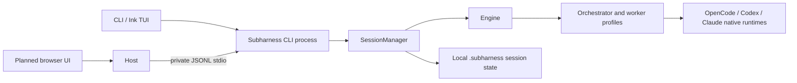

# Subharness system overview

Subharness is one local-first agent system. The CLI/TUI is the current interface. A web UI is planned as another client for the same sessions and engine; it does not bring a second orchestrator or agent runtime.

## System shape



The Node host is a trusted local process. It starts the existing CLI JSONL bridge and exposes a browser-safe API; the CLI child owns `SessionManager` and `Engine`. Native provider authentication stays on the user's machine. The JSONL stdio protocol is for trusted child processes; browsers cannot launch it directly and it must not be exposed on a network interface.

## Stack

| Layer | Stack | Status |
|---|---|---|
| Agent runtime | Node.js 24+, TypeScript, `SessionManager`, `Engine`, native OpenCode/Codex/Claude adapters | Implemented for the CLI |
| CLI/TUI | Node.js CLI, React + Ink | Implemented |
| Web UI | React + TypeScript + Vite + Tailwind | Planned |
| Local host/API | Node.js + TypeScript; translates browser HTTP/events to the existing CLI protocol | Planned; no HTTP host yet |
| Persistence | Existing local JSON sessions under `.subharness` | Implemented; no cloud database or account service in this MVP |

No model credentials, OAuth tokens or provider sessions move into the browser. The local host must bind to loopback, serve the UI from the same origin, validate requests, and require a per-instance token. Do not add CORS wildcard access or expose the process to the LAN.

## What exists today

- `src/engine.ts` plans work, selects workers, executes native harness calls, checkpoints session state and handles stop/retry/steering.
- `src/application.ts` provides `SessionManager` for profiles and sessions.
- `src/protocol.ts` implements JSONL stdio v1 for a trusted Node host.
- `src/contracts.ts` supplies browser-safe protocol types/validation; `profiles.readiness` returns local setup checks before session creation. `fixtures/protocol/` supplies complete synthetic UI examples.
- `src/ui.tsx` and `src/workspace-ui.tsx` are the current terminal interface.
- `profiles/`, `.agentpack` bundles and OCI images provide the existing profile and sharing system.
- The sessions and native run references are local. There is no browser API, remote sync, cloud runner or multi-user account service.

## Repository layout

```text
bin/          CLI executable
src/          CLI runtime, Engine, SessionManager, adapters, TUI and JSONL protocol
profiles/     Built-in orchestrator/worker profiles and their skills
examples/     Team examples
fixtures/     Browser-safe protocol and screen examples; simulation only
test/         Automated fixtures and opt-in live checks
benchmarks/   Small coding-agent benchmark
docs/         Runtime architecture, UI protocol, setup and handoffs
web/          Planned web client; create when its implementation starts
server/       Planned local HTTP host; create when its implementation starts
```

The existing source tree stays in place. The web and host work should reuse the engine through the local protocol, not move CLI files into a new monorepo or duplicate planning logic. Cloud hosting, database sync and remote execution are outside the current local-first scope.

## Implementation order

1. Add the local Node host that starts one `serve --stdio` child for a fixed project/state directory and bridges it to a browser-safe HTTP/event API.
2. Build the web UI against that API using the current session, task, profile, diff and permission-request shapes.
3. Preserve existing profile trust prompts, native provider authentication, local project permissions and saved-session behavior.
4. Consider remote accounts/sync only after local UI and runner work as one complete flow.

See [runtime architecture](ARCHITECTURE.md), [JSONL protocol](UI_PROTOCOL.md), [web UI handoff](HANDOFF_UX_UI.md), [local host handoff](HANDOFF_BACKEND.md), and [current gaps](PROJECT_GAP_ANALYSIS.md).
